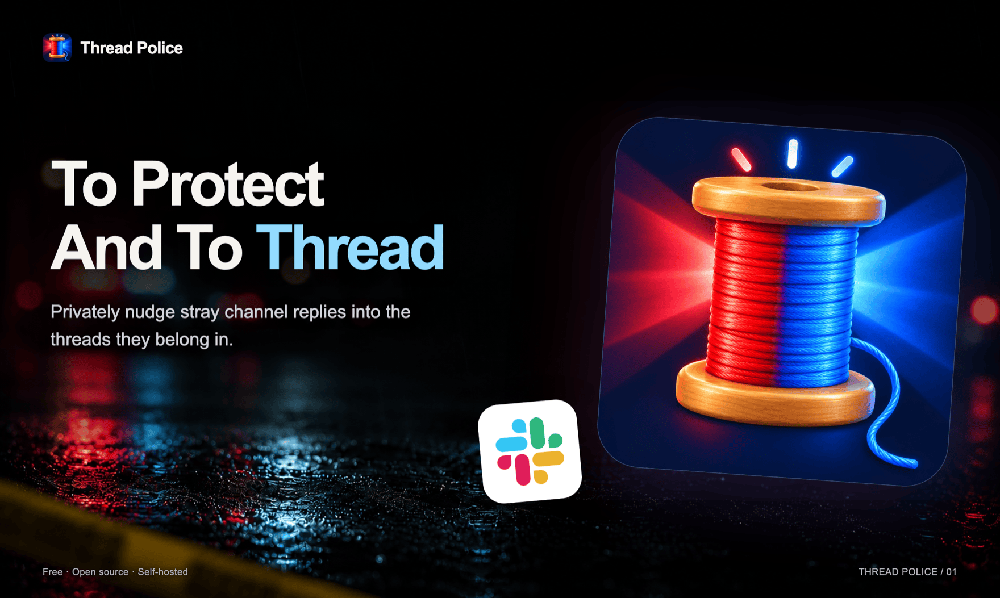
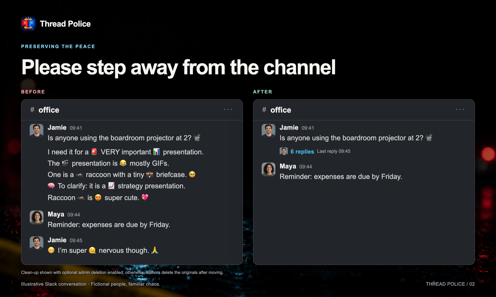
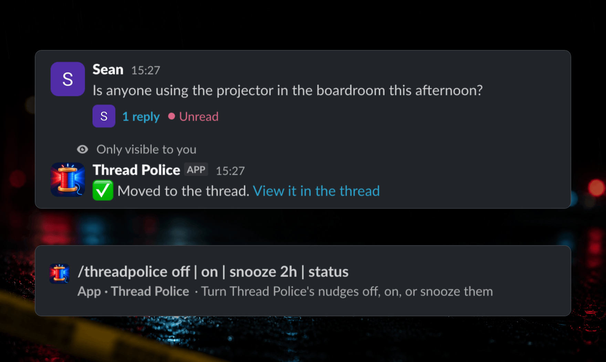
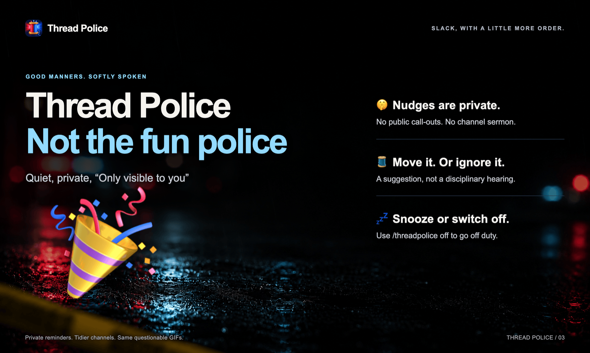
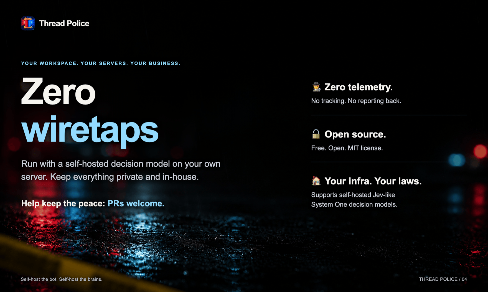

  

<h1 align="center">🚨 Slack Thread Police 🧵</h1>

  A <strong>free, open-source, self-hosted and private</strong> Slack bot that keeps channels tidy by nudging users to thread their messages. Powered by a system one decision model.

  

## What it does

When someone posts a top-level message that belongs in the thread of a recent message (most often a follow-up to their own earlier message, or a reply to someone else's), Thread Police sends them a private nudge ("Only visible to you").

Say Sam posts this in `#engineering`:

> **Sam** 10:02  
> Does anyone know when the staging deploy is happening today?
>
> **Sam** 10:03  
> Asking because I need to get a migration in before it goes out

Immediately after, only Sam sees:

> 🧵 This looks like a follow-up to your earlier message:
> > Does anyone know when the staging deploy is happening today?
>
> Move it, and any follow-ups, into the thread?
>
> `Move to thread`   `Ignore`

One click on **Move to thread**, and the channel reads:

> **Sam** 10:02  
> Does anyone know when the staging deploy is happening today?  
> 💬 1 reply: *Asking because I need to get a migration in before it goes out*

Here's what it looks like in Slack once a follow-up has been moved:

**Move to thread** reposts the messages into the right thread under the author's name and avatar, then tells them they can delete the originals (or deletes them itself, if you allow it). **Ignore** dismisses the nudge. Nobody else sees anything, and anyone can turn nudges off for themselves with `/threadpolice off`.

## Benefits

The channel stays easy to scan: each question keeps its context, and the back-and-forth happens in its thread. Thread replies only notify the people taking part, so the rest of the channel isn't marked unread or pinged for every follow-up. And because each nudge is a quiet, private reminder, people soon pick up the habit and start threading on their own.

## AI agent setup

Each workspace runs its own copy: you create a Slack app from the included manifest and run the bot on your own computer or server, with Docker or plain Node. It connects to Slack using Socket Mode, so it needs no public URL.

If you use an agent that can drive your browser and a shell (for example Claude Code with Claude in Chrome), paste the prompt from [`AGENT_SETUP.md`](AGENT_SETUP.md) into it. It asks you a few questions, creates the Slack app, collects the keys from your browser into a locked-down env file, starts the bot locally or on your server, and tests it.

Prefer to do it yourself? Follow the [manual setup](docs/setup.md).

## Commands

Replies are private, so only you see them. `/threadpolice` on its own, or `/threadpolice help`, lists them all.

| Command | What it does |
| --- | --- |
| `/invite @Thread Police` | Add the bot to the current channel. It only reads channels it's in. |
| `/threadpolice off` | Stop nudging me. |
| `/threadpolice snooze 2h` | Pause nudges for a while: minutes, hours, days or weeks (`30m`, `2h`, `3d`, `1w`), up to 90 days. |
| `/threadpolice on` | Turn nudges back on. |
| `/threadpolice status` | Show whether nudges are on, off or snoozed. |
| `/threadpolice stats` | How many nudges went out in the last hour, 24 hours, 7 days, 30 days and all time, how many were moved or ignored, and the most nudged channels. |
| `/threadpolice join #eng #design` | Admins and owners: add the bot to these public channels. |
| `/threadpolice join all` | Admins and owners: add the bot to every public channel. |

Admins can also add channels from the bot's **Home** tab. See [How it works](docs/how-it-works.md) for the details.

## Privacy

- **Message content is never persisted.** The bot keeps a small rolling window of recent top-level messages per channel in memory, and only for channels it has been invited to. A restart forgets everything.
- It writes two files to `DATA_DIR`: `preferences.json`, the user ids of people who turned nudges off or snoozed them and until when; and `stats.json`, how many nudges each channel got and how many were moved or ignored (channel ids and numbers only, not who was nudged).
- To decide whether a message is a reply, the bot sends the new message and the recent window to the decision model ([TypeSafe](https://typesafe.ai)'s hosted Jev by default, or [a model you host yourself](docs/configuration.md#self-hosting-the-model)). Nothing else leaves your infrastructure.
- Logs never include message text at the default `LOG_LEVEL=info`; they show message ids, probabilities and counts. At `LOG_LEVEL=debug`, Slack's Bolt SDK logs raw event payloads, which do include message text.
- Nudge buttons carry only message ids, never content.

## Learn more

- [How it works](docs/how-it-works.md): how it decides, the `/threadpolice` commands, and what Move does.
- [Manual setup](docs/setup.md): creating the Slack app by hand, and running it on your own server.
- [Configuration](docs/configuration.md): every setting, and running your own decision model.
- [Roadmap](BACKLOG.md): planned and possible work.
- Development: `pnpm typecheck`, `pnpm test` and `pnpm build` must pass. See [CLAUDE.md](CLAUDE.md) for the code layout.

## License

[MIT](LICENSE) © Parklife, Inc.
